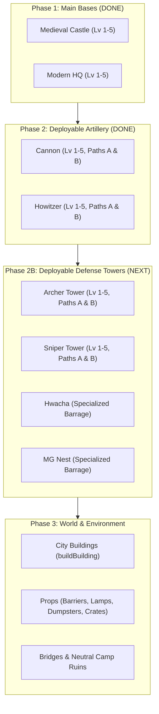

# EraClash: Building Design, Architecture & Animation Master Plan

> **Purpose**: This document provides a complete technical, visual, and architectural guide for discussing and planning improvements to all building models and animations in **EraClash**. Use this guide to align on art direction, structure rigging, upgrade progression, and procedural animation systems across both Medieval and Modern factions.

---

## 1. Technical Context & Engine Architecture

### 1.1 Tech Stack & Modeling Philosophy
* **Engine**: [Three.js](file:///c:/Users/Admin/EraClash/vendor/three.module.js) (ESM) loaded in browser via standard `<script type="importmap">`.
* **Rendering Style**: Stylized low-poly / composite voxel-adjacent box aesthetic.
* **Procedural Assembly**: All buildings, towers, and environmental props are constructed purely via code in [`js/models.js`](file:///c:/Users/Admin/EraClash/js/models.js). **No external 3D mesh files (.gltf, .obj) are used.** This ensures zero download latency, crisp geometric shadows, unified palette shading, and total modularity for upgrades and animations.
* **Core Modeling Primitives**:
  * `B(parent, w, h, d, color, x, y, z, mats, opts)`: Creates and positions a Three.js box mesh.
    * `mats`: Optional `Map` or `null` for caching/sharing materials (essential for hit-flash emissive effects).
    * `opts`: Optional `{ emissive, opacity, transparent, roughness, metalness }`.
  * `pivot(parent, x, y, z)`: Creates a helper `THREE.Group` positioned at an offset to serve as a rotation or articulation hinge (e.g., turret yaw, barrel pitch, radar axle, flag hinge).

### 1.2 Coordinate System & Base Layout Contracts
* **Map Axis**: The match lane runs along the **X-axis** (`x = -60` to `x = +60`), with `z` representing lane width (`z = -15` to `+15`), and `y` representing height (`y = 0` is ground level).
* **Medieval Castle**: Positioned at `x = -58`. Faces **`+x`** (toward the center river).
* **Modern HQ**: Positioned at `x = +58`. Faces **`-x`** (toward the center river).
* **River / Centerline**: Centered at `x = 0`.
* **Footprint Contract**: Defined in [`js/config.js`](file:///c:/Users/Admin/EraClash/js/config.js) as `baseHalfX: 6, baseHalfZ: 7` (12 × 14 unit bounding footprint).
* **Troop Slot Contract**: Base levels 1 through 5 strictly support **1, 2, 4, 6, and 8 garrison troops** respectively, positioned on fighting platforms behind parapets/embrasures.

---

## 2. Current Implementation Status

### 2.1 Modern HQ Base (FOB / Military Command Theme) — COMPLETED
* **Lv 1 — Field Outpost (1 slot)**:
  * Corrugated shipping container tactical bunker.
  * Flush camo canvas awning supported by grounded steel posts and angled rafters.
  * Raised timber sniper duckboard platform at `y = 2.95` behind a sandbag breastwork (prevents troop boots from clipping).
  * Field power generator with cooling ribs, satcom mast with flashing beacon, fuel drums, and unobstructed front windows.
* **Lv 2 — Forward Command (2 slots)**:
  * Two-story reinforced concrete and olive-drab tactical command bunker.
  * Heavy Jersey blast barriers, steel blast door, satcom dish, dual whip antennas, and alternating red/blue hazard light bar.
  * 2nd-floor catwalk observation deck with angled ballistic gun shields (`y = 6.2`).
* **Lv 3 — Command HQ (4 slots)**:
  * Brutalist operations center with recessed blast gates, ribbon windows, and security bollards.
  * Rooftop helipad with yellow "H" and perimeter landing lights.
  * Mechanical penthouse with animated spinning HVAC fan, lattice comms mast with flashing red obstruction beacon.
* **Lv 4 — Military Compound (6 slots)**:
  * Twin 4-leg steel lattice watchtowers with animated sweeping searchlights (slots 5 & 6 at `y = 11.2`).
  * Hesco dirt bastions, razor-wire coils, and motorized 360° rotating radar dish.
* **Lv 5 — Tech Tower / Citadel (8 slots)**:
  * Soaring rear Cyber Command Spire with cyan telemetry circuit lines (`0x00e5ff`) and tinted cyber glass.
  * Animated dual-barrel CIWS Gatling defense turret sweeping a defensive perimeter arc.
  * Active phased radar array.
  * Attack gunship helicopter parked on the helipad featuring a tandem cockpit, nose FLIR turret, rocket pods, and spinning quad-rotors.
  * High-ground sniper platforms at `y = 18.5` (slots 7 & 8).

### 2.2 Medieval Castle Base (Norman Keep to Imperial Citadel) — COMPLETED
* **Lv 1 — Wooden Fort (1 slot)**:
  * Frontier Motte-and-Bailey log blockhouse with interlocking timber joints.
  * Raised timber combat platform at `y = 7.0` with plank roof shelter.
  * Sharpened log palisade perimeter (*cheval de frise*), pitch brazier on oak post, and faction banner.
* **Lv 2 — Stone Keep (No Towers) (2 slots)**:
  * Heavy Norman rectangular stone masonry keep with stepped corner buttresses (deliberately **tower-free** to make the jump to Level 3 dramatic).
  * Corbelled stone machicolation cornice with timber bracket supports.
  * Roof battlements with 2 front embrasures (`y = 8.5`) and wooden patrol walkway (*chemin de ronde*).
  * Arched stone portal with separate 3D pillars, recessed oak door, iron portcullis bars, torches, and faction banners.
* **Lv 3 — Castle (4 slots)**:
  * 4 massive corner towers (`3.4 × 13.0 × 3.4`) capped with steep red-shingled conical spires with gold finials.
  * Protruding front gatehouse barbican and 4 front wall archers (`y = 9.0`).
* **Lv 4 — Fortress (6 slots)**:
  * Concentric citadel featuring a massive central Great Donjon (`y = 15.5`).
  * Front tower fighting platforms for archers 5 & 6 (`y = 13.0`).
  * Heraldic knight shields mounted along the outer walls.
* **Lv 5 — Royal Citadel (8 slots)**:
  * Soaring imperial donjon with gold crenellations and royal tapestries (archers 7 & 8 at `y = 17.0`).
  * Regal purple/gold roof pavilions on rear towers.
  * Heavy bronze roaring fire braziers on carved stone plinths flanking the courtyard.

### 2.3 Deployable Artillery Overhaul (Medieval & Modern) — COMPLETED
All 16 artillery models across both factions (Levels 1–5, Paths A & B) have been overhauled with physicalized rigging, distinct silhouettes, custom clutter, and specialized animations:
* **Rigging Contract (`structureRig`)**: `root -> chassisRock -> body -> yaw -> barrel -> recoils[] -> muzzles[]`, plus `touchholes`, `drum`, `glow`, `exhaust`.
* **Physics Systems**:
  * **Medieval Cannon Wheel-Rock**: $4.3^{\circ}$ pitch kick (`chassisRock.rotation.x = -0.075 * sin(rt * PI)`) and $0.10$ rollback with smooth wheel return. Volleys fire in ripple waves with staggered recoil.
  * **Modern Howitzer Two-Stage Hydraulics**: Instant slam-back kick in $\sim 0.04\text{s}$ followed by smooth pneumatic ease-out recovery over $\sim 0.4\text{s}$ (`(rt/0.82)^1.8`), with hydraulic spade ground shock damping.
* **Verification Status**:
  * Cannon Lv 1 (Field Cannon): 57 boxes (< 70 max) — spoked wheels, iron tire, quoin, touchhole, cannonballs, water bucket, ramrod.
  * Cannon Lv 2 (Bronze Cannon): 66 boxes (< 70 max) — bronze hubcaps, tulip crown, screw quoin, 6-ball pyramid, powder keg, dual swabs.
  * Cannon A3 (Bombard): 52 boxes (< 95 max) — stubby massive bore, reinforcing hoops, giant stone cannonballs.
  * Cannon A4 (Siege Mortar): 33 boxes (< 95 max) — timber bed baulks (no wheels), ground anchor spikes, $60^{\circ}$ mortar bowl, bomb trough, powder shovel.
  * Cannon A5 (Great Bombard): 76 boxes (< 140 max) — 4-wheel double-axle carriage, monster dragon head muzzle with ruby eyes and white fangs, gold rings, twin crimson banners.
  * Cannon B3 (Twin Cannons): 49 boxes (< 95 max) — triple carriage cheeks, dual independent recoil barrels and touchholes.
  * Cannon B4 (Grapeshot Battery): 94 boxes (< 95 max) — 3-barrel radial fanned blunderbuss array (3.5° outward fan), flared bronze bells with polished brass rims and dark hollow bore openings (no colliding yellow bars), fortified embrasured timber mantlet, 8-faceted spoked wheels with felloes, elevation screw crank, open ammo chest with 2 tin canister shot rounds, and authentic quilted rope grapeshot stand with flank swab tool.
  * Cannon B5 (Thunder Organ): 137 boxes (< 140 max; 128 structure + 9 scaffold) — zero Z-fighting overhaul: sub-barrel steel cradle (no coplanar breeches), armored steel pavise mantlet with open barrel embrasure and observation vision slit, mortise-stepped 8-spoke artillery wheels with brass hubcaps, unified sloping oak trail with parented recoil spade shoe and lunette, 7 independent recoil iron barrels with bronze cascabels, drilled brass touchholes (registered in `r.touchholes` for synchronized sequential sparks), bronze astragals, brass muzzle mouth collars, dark hollow bore openings, continuous elevated brass powder train trough with black gunpowder core, and rich siege clutter (open ammo chest with tin canister shot round, oak sabot, paper powder cartridge, heavy banded powder keg with red bung, and gunner's linstock staff with glowing slow-match ember).
  * Howitzer Lv 1 (Field Howitzer): 69 boxes (< 70 max) — sandbag corners, towed carriage, shield halves + apron, recuperator over the tube, split trail with dug-in spades, ammo crate.
  * Howitzer Lv 2 (Heavy Howitzer): 68 boxes (< 70 max) — front sandbag berm, bigger wheels, wing mantlets, twin recuperators, bore evacuator, double-baffle brake, ballistic terminal, ready rack.
  * Howitzer A3 (Long Tom): 77 boxes (< 95 max) — concrete gun pit, octagonal turntable, pedestal + tall cheeks, equilibrators, 4.4 m tube, rear crew deck with rail, rangefinder, ready rack.
  * Howitzer A4 (Guided Shells): 92 boxes (< 95 max) — Long Tom + braced radar mast with spinning dish (`r.radar`), fire-control computer cabled to it, laser designator, finned guided rounds, fuze setter.
  * Howitzer A5 (Railgun): 91 boxes (< 140 max) — armoured turret with glacis, twin rails with 6 glowing coils + bore line, capacitor banks with glowing cells and power cables, cooling stack (`r.glow`).
  * Howitzer B3 (Autoloader): 93 boxes (< 95 max) — Lv 2 carriage + 6-round drum magazine on an axle (`r.drum`), rear strut to the trail, hydraulic power pack, ammo pallet.
  * Howitzer B4 (MLRS): 85 boxes (< 95 max) — static 6-wheel truck (cab, jacks, mudguards), launcher turntable on the bed (`r.yaw`), 6-rocket pod whose rockets pull into the tubes on fire (`r.recoil`), back-blast (`r.exhaust`).
  * Howitzer B5 (Thermobaric): 104 boxes (< 140 max) — static tracked hull (road wheels, skirts, reactive armour, cupola), armoured 8-rocket launcher with hazard bands, beacon, back-blast.
  * All Howitzer designs are one connected piece in every pose: `node scripts/check-models.mjs howitzer`.

### 2.4 Shared Architectural & Animation Standards Established
1. **Flag & Stripe Lockstep Rig**:
   * Previously, flag stripes floated or detached during animation. Now, `addFactionFlag(...)` mounts the cloth banner and emblem meshes into a unified `flagGroup` whose local origin is exactly at the flagpole axis (`x = 0, z = 0`). Flapping rotates the entire group (`flagGroup.rotation.y`), guaranteeing 100% lockstep waving.
2. **Zero Z-Fighting Principle**:
   * Three.js Lambert materials sharing identical planes flicker aggressively. All overlapping features are given physical 3D relief (e.g., doors recessed by `0.24`, walkways elevated by `+0.04`, wall trim offset by `+0.02` to `+0.05`).
3. **Dual Animation Hookup**:
   * Animations run in both the live match ([`js/world.js`](file:///c:/Users/Admin/EraClash/js/world.js), [`js/unit.js`](file:///c:/Users/Admin/EraClash/js/unit.js)) and the model inspection suite ([`js/dev/devlab.js`](file:///c:/Users/Admin/EraClash/js/dev/devlab.js)).

---

## 3. Scope of Remaining Buildings Needing Overhaul



---

## 4. Phase 2B: Deployable Defense Towers (Detailed Roadmap)

### 4.0 Extended Artillery Rigging Architecture (`structureRig`)
The base structure rig in [`js/models.js`](file:///c:/Users/Admin/EraClash/js/models.js) has been upgraded from a single linear hierarchy to an array-ready, multi-channel physicalized artillery rig:
* **Rig Hierarchy**: `r.root` $\to$ `r.chassisRock` $\to$ `r.body` $\to$ `r.yaw` $\to$ `r.barrel` $\to$ `r.recoils[]` $\to$ `r.muzzles[]`.
* **Carriage Suspension / Rocker Pivot (`r.chassisRock`)**:
  * **Cannon**: Rocks upward by $4.3^{\circ}$ (`-0.075 rad`) and shifts backward upon firing, then rolls back into place as the wheels settle.
  * **Howitzer**: Simulates hydraulic spades biting into the dirt and ground shock absorption (`-0.025 rad` / `-0.04` recoil shift).
* **Multi-Recoil & Multi-Muzzle Arrays**: Supports `r.recoils = []` and `r.muzzles = []` alongside fallbacks `r.recoil` and `r.muzzle`. Multi-barrel guns fire in sequence or volley.
* **Auxiliary Animation Hooks**:
  * `r.drum`: Revolving ammo cylinder (Autoloader).
  * `r.glow`: Cached mesh/material references for capacitive pulse charging (Railgun).
  * `r.exhaust`: Rear-facing back-blast smoke and flame vent (MLRS & Thermobaric).
  * `r.touchholes`: Drilled breech vent smoke/flash anchors (Cannon).
* **DevLab Interactive Harness**:
  * The Dev Lab inspector includes an interactive **"💥 Fire Artillery / Test Recoil"** button to trigger single fire pulses, test physicalized carriage rock, and verify muzzle flashes on demand.

### 4.1 Cannon (Medieval Artillery)
* **Upgrade Tree**:
  * **Lv 1 — Field Cannon (Baseline Complete — 57 boxes)**:
    * Light 2-wheel wooden cart with aged oak planks (`0x5a3e26`), iron tires, 8-part faceted spoked wheels, and central trail beam resting on ground with iron shoe.
    * Stepped quoin elevation wedge under breech.
    * Stepped cast-iron barrel with cascabel knob, astragals, and drilled brass touchhole.
    * Field clutter: 3 stacked cannonballs in a hemp rope ring, wooden water bucket with iron hoops, and sheepskin swab ramrod strapped along the flank.
  * **Lv 2 — Bronze Cannon (Baseline Complete — 66 boxes)**:
    * Reinforced iron-banded oak chassis with iron coping rails and double bolt plates.
    * Larger spoked wheels with polished brass hubcaps and heavy iron rims.
    * Polished cast bronze barrel (`0xa87428`) with gold reinforcing rings, tulip muzzle crown, and brass flashpan.
    * Elevating brass screw crank mechanism.
    * Clutter: 6-cannonball pyramid stack, wooden powder keg with black iron hoops and red bung, dual flank tools (ramrod & worm swab).
  * **Path A (Heavy Kinetic Siege)**:
    * **A3 — Bombard**: Short, massive bore stubby iron barrel with thick hoop reinforcing rings.
    * **A4 — Siege Mortar**: High-angle heavy timber firing bed, no front wheels, massive bowl mortar.
    * **A5 — Great Bombard**: Dragon-mouthed monster gun with gold filigree, faction banners, chained ground anchor stakes.
  * **Path B (Rapid Volley & Saturation)**:
    * **B3 — Twin Cannons**: Dual over-under iron barrels with independent firing vents.
    * **B4 — Grapeshot Battery**: 3-barrel radial fanned blunderbuss array (3.5° outward fan), flared bronze bells with polished brass rims and dark hollow bore openings, fortified embrasured timber mantlet, 8-faceted spoked wheels, elevation screw crank, open ammo chest with tin canister rounds, and authentic quilted rope grapeshot stand.
    * **B5 — Thunder Organ (Overhauled — 137 boxes)**: 7-barrel ribauldequin spread horizontally across an armored broad cart with open-embrasure steel pavise mantlet, sub-barrel cradle, continuous elevated brass powder train trough, 7 independent recoil units with drilled touchholes and flash muzzles, and complete siege artillery field clutter (ammo chest, canister round, powder keg, glowing linstock staff).

### 4.2 Howitzer (Modern Artillery) — overhauled v0.25.1
* **Family look**: concrete pad, olive + steel, spades dug into the ground. Path A stays a fixed gun pit and grows taller and more high-tech; path B goes mobile.
* **Rig rules**: the tube recoils inside a fixed cradle on `r.barrel`; the cradle hangs on a trunnion axle on the pitch axis, so nothing comes loose at any elevation or recoil. On B4/B5 the vehicle sits on `r.body` and only the launcher turns on `r.yaw`.
* **Lv 1 — Field Howitzer**: towed M101-style gun, sandbag corners, split shield, recuperator, split trail.
* **Lv 2 — Heavy Howitzer**: M198-style, front berm, wing mantlets, twin recuperators, bore evacuator, double-baffle brake.
* **Path A (Precision)**: A3 Long Tom (gun pit, pedestal, 4.4 m tube, crew deck) → A4 Guided Shells (+ radar mast, fire-control computer, laser designator) → A5 Railgun (armoured turret, glowing rails and capacitor banks).
* **Path B (Saturation)**: B3 Autoloader (drum magazine) → B4 MLRS (6-wheel truck, 6 rockets) → B5 Thermobaric (tracked hull, 8 rockets).

### 4.3 Archer Tower (Medieval Defense)
* **Upgrade Tree**:
  * **Lv 1**: Timber Watchtower (rough-hewn wood scaffolding legs and plank floor).
  * **Lv 2**: Stone Watchtower (squared stone masonry shaft, wooden hoarding).
  * **Path A (Sharpshooter / Piercing)**:
    * **A3 — Longbow Tower**: Tall stone tower with open shooting embrasures.
    * **A4 — Ballista Tower**: Swiveling heavy torsion ballista mounted on the deck.
    * **A5 — Skypiercer**: Giant iron-reinforced siege ballista firing massive metal bolts.
  * **Path B (Volley / Swarm)**:
    * **B3 — Twin Archers**: Dual bowmen standing shoulder to shoulder.
    * **B4 — Fire Archers**: Burning pitch pots on deck, flaming arrows and glowing embers.
    * **B5 — Arrow Storm Spire**: Ornate multi-tier turret with 4 archers and an aerodynamic spire.
* **Areas for Improvement**:
  * **Visual Details**: Weathered shingle patterns, arrow quiver racks, rope winches, hanging decorative heraldry, protective wicker pavises.
  * **Animations**:
    * Ballista winch and arm snap-back animation when firing.
    * Crew draw-and-release bow animations.
    * Torch flame / pitch pot ember flicker on the Fire Archer tower.
    * Roof pennant waving with the wind.

### 4.4 Sniper Tower (Modern Defense)
* **Upgrade Tree**:
  * **Lv 1**: Steel Guard Tower (lattice steel pipe legs, sheet metal parapet).
  * **Lv 2**: Reinforced Overwatch (camo skirt, sandbags, searchlight).
  * **Path A (Marksman / Anti-Materiel)**:
    * **A3 — Marksman Post**: Ghillie net canopy, spotter optics, precision rifle.
    * **A4 — Anti-Materiel Nest**: Heavy .50 BMG rifle on a pintle swivel mount with bipod.
    * **A5 — Deadeye Sentinel**: Reinforced concrete pillar bunker with armored glass slit and heavy cyber-assisted sniper rifle.
  * **Path B (Fire Team / Spotter)**:
    * **B3 — Spotter Team**: Sniper paired with a binoculars-wielding spotter officer.
    * **B4 — Suppression Team**: 3-man crew with a tripod mounted squad automatic weapon (SAW) and sandbags.
    * **B5 — Drone Command**: Roof helipad with a parked surveillance/strike drone and telemetry mast.
* **Areas for Improvement**:
  * **Visual Details**: Textured ghillie netting strands, solar panels, laser rangefinder lenses, spent casing piles, comms wires, satellite antenna dishes.
  * **Animations**:
    * Mounted .50 cal barrel recoil and sniper bolt cycle.
    * Drone rotor spin and liftoff hover during missile barrage skill.
    * Searchlight tracking target azimuth.
    * Flashing status LEDs and radar dish rotation.

### 4.5 Hwacha (Medieval Barrage Tower)
* **Current State (v0.25.0)**: Full 5-level tree in `js/buildtree.js` with 8 models: Lv 2 Iron-Banded Hwacha; path A Singijeon (Daesingijeon Rack → Fire Dragon Rack → Thunder Rocket Battery: big rockets, burning ground, stun); path B Ripple Fire (Twin Hwacha → Munjong Hwacha → Whirlwind Battery: more rockets, slows, two groups per salvo). Ripple-fire launch animation and cart rocking are still open.
* **Proposal for Discussion**:
  1. **Visual Overhaul**: Historic Joseon-inspired aesthetic with iron-spoke wagon wheels, curved blast shields, wooden elevation ratchet, and paper rocket fuses.
  2. **Upgrade Progression (Potential 3-5 Tiers)**:
     * *Lv 1 — Basic Hwacha*: 20-tube wooden cart.
     * *Lv 2 — Reinforced Hwacha*: Bronze-plated cart, 40-tube launcher, side mantlets.
     * *Path A (Incendiary/Singijeon)*: Heavy fire-arrow warheads leaving burning ground.
     * *Path B (Rapid Volley/Whirlwind)*: Twin cart battery or revolving rocket drum.
  3. **Animations**: Sequential ripple-fire (rockets launching tube-by-tube with exhaust smoke), cart recoil rocking backwards.

### 4.6 Machine Gun Nest (Modern Barrage Tower)
* **Current State (v0.25.0)**: Full 5-level tree in `js/buildtree.js` with 8 models: Lv 2 Fortified Pillbox; path A Heavy Caliber (Heavy MG Post → Twin .50 Bunker → Autocannon Bunker: AP rounds, splash, anti-air); path B Rotary (Gatling Nest → Minigun Nest → Vulcan CIWS: spinning barrels, multi-target, slows, true sight). Belt scrolling, heat glow and brass ejection are still open.
* **Proposal for Discussion**:
  1. **Visual Overhaul**: Hexagonal or pillbox bunker with sloped armor skirts, spent brass chute, spade-grip heavy machine gun with cooling shroud, and green ammo cans with looping link belts.
  2. **Upgrade Progression (Potential 3-5 Tiers)**:
     * *Lv 1 — Sandbag MG Post*: Open trench with M2 .50 cal.
     * *Lv 2 — Fortified Pillbox*: Reinforced concrete bunker with ballistic glass vision slits.
     * *Path A (Heavy Caliber / Anti-Armor)*: Twin .50 cal or 20mm autocannon emplacement.
     * *Path B (Rotary Vulcan / Suppression)*: Electric 6-barrel Gatling minigun with massive ammo drum and radar sensor.
  3. **Animations**:
     * Ammo belt scrolling into feed tray.
     * Barrel spinning (for Gatling) or vigorous reciprocating barrel recoil.
     * Barrel heat discoloration (orange thermal glow after sustained firing).
     * Brass casings ejecting and bouncing.

---

## 5. Phase 3: World & Environmental Architecture

### 5.1 City Buildings (`buildBuilding`)
Currently, world buildings in [`js/models.js`](file:///c:/Users/Admin/EraClash/js/models.js) line 2065 are plain single-colored rectangular prisms with flat window dots.
* **Goals**:
  * **Varied Architectural Typologies**:
    * *Commercial/Offices*: Flat roofs with parapets, glass entrance facades, HVAC chillers, and radio antennas.
    * *Residential Brownstones*: Stepped front porches (stoops), fire escapes, brick cornices, and chimneys.
    * *Warehouses / Industrial*: Corrugated metal walls, saw-tooth roofs with skylights, loading docks, and roll-up shutter doors.
    * *Ruined / Battle-Damaged*: Blown-out windows, cracked brickwork, exposed rebar, and rubble mounds.
  * **Roof Details**: Water towers, ventilation ducts with spinning extractor fans, satellite dishes, and access doors.
  * **Ground-Floor Integration**: Storefront awnings, display windows, alley dumpsters, and fire hydrants.

### 5.2 Environmental Props & Street Furniture
* **Current Props**: `buildLamp`, `buildTorch`, `buildBarrel`, `buildDumpster`, `buildFence`, `buildBarrier`, `buildCrate`, `buildPond`, `buildFountain`, `buildBench`, `buildPlanter`.
* **Enhancement Ideas**:
  * Street lamps with soft volumetric light cones or ground spot glow.
  * Explodable/flammable hazard barrels with warning markings.
  * Medieval market stalls with canvas awnings, vegetable crates, and weapon racks.
  * Stone bridge archways spanning the center river with weathered flagstones and stone piers.

---

## 6. Procedural Animation Architecture & Standards

### 6.1 Structure Animation Contracts
When animating structures in `EraClash`, respect the following standard hooks:

| Animation Target | Object Rig Property | Update Location | Expected Behavior |
| :--- | :--- | :--- | :--- |
| **Turret Yaw** | `r.yaw.rotation.y` | `Unit.updateStructure` | Smooth rotation to face the targeted enemy. |
| **Barrel Elevation** | `r.barrel.rotation.x` | `Unit.updateStructure` | Pitch up/down based on projectile trajectory/distance. |
| **Recoil Stroke** | `r.recoil.position.z` | `Unit.animate` | Snaps back on shot (`-0.1` to `-0.45`), then spring-returns to `0`. |
| **Muzzle Flash** | `r.muzzle.visible` | `Unit.animate` | Flickers visible for 0.06–0.1s during weapon release. |
| **Radar / Spun Assets** | `r.radar.rotation.y` | `Unit.animate` / `world.js` | Continuous constant rotation (`dt * 1.5`). |
| **Hazard / Nav Lights** | `r.blink.material.color` | `Unit.animate` / `world.js` | Toggles or pulses on timer. |
| **Rotary Gun / Fans** | `r.fan.rotation.y` / `r.rotor.rotation.y` | `world.js` / `devlab.js` | High-speed rotation (`dt * 6.0` to `8.0`). |
| **Ambient Braziers** | `flame.scale` / `flame.position` | `world.js` / `devlab.js` | Subtle random per-frame noise for flickering flame. |

### 6.2 Code Pattern for Adding Animatable Components
```javascript
// Example: Creating an animated rotating radar or turret in a structure model
const radarGroup = pivot(r.body, x, y, z);
// Add visual parts to radarGroup...
B(radarGroup, 0.2, 0.8, 1.2, 0xd0d4da, 0, 0, 0, m);

// Register on rig so update routines can find it
r.radar = radarGroup;
```

---

## 7. Key Discussion Points & Decision Matrix for Next AI

When planning implementation with your next assistant, focus on resolving these specific questions:

1. **Hwacha & MG Nest Upgrade Paths**:
   * *Decided (v0.25.0)*: full 5-level trees, built as a pair (path A heavy hits past armor, path B more shots that slow).
2. **Visual Fidelity vs Performance Budget**:
   * *Budget*: Target under ~300 mesh boxes per base and under ~150 mesh boxes per deployable tower to preserve 60 FPS performance on lower-tier GPUs and mobile web browsers.
   * *Material Caching*: Continue using the shared `mats` map so material instances are minimized and batchable by Three.js.
3. **Faction Architectural Styling**:
   * *Medieval Faction*: Should high-tier upgrades lean into grounded historical European feudal architecture (Norman, Romanesque, Gothic), or introduce subtle mythical elements (runic carvings, glowing crystals, dragon gargoyles)?
   * *Modern Faction*: Should high-tier upgrades stay strictly military-industrial (brutalist concrete, drab camo, steel armor), or push further into near-future sci-fi (holographic sights, carbon fiber armor, railguns, cybernetic telemetry)?
4. **Destruction & Death Animations**:
   * Currently, destroyed structures tilt sideways and sink into the ground (`y = -deathT * 0.8`).
   * *Opportunity*: Can we introduce procedural crumbling (masonry blocks tumbling outward) or smoke/fire debris for destroyed buildings?
